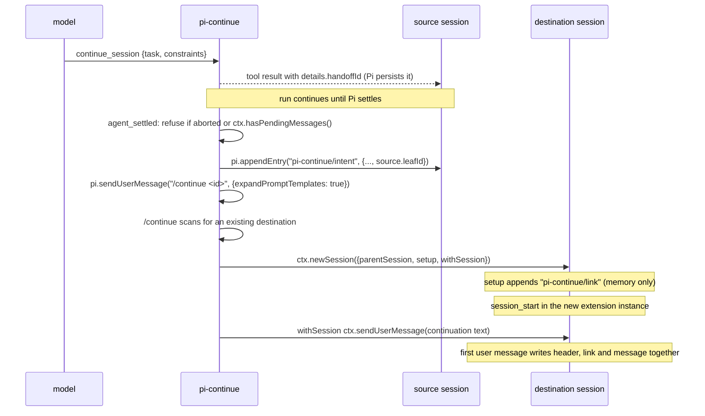

# pi-continue handoff

## Goal

Start each continuation in a fresh Pi session that carries no prior transcript and no summary. The new session gets only three things: the current task, the exact active constraints, and a reference to its source (session file, session ID and finalized leaf ID). Prior history stays on disk. The model reads it on demand through a read-only retrieval tool that follows source links across successive continuations.

This is a self-contained Pi extension. It needs no change to Pi and no upstream PR.

## Status

Nothing is implemented. This repository holds only tooling.

```
~/src/pi-continue
  package.json       pi manifest points at ./src/extension.ts (not yet written)
  oxlint.config.ts   ultracite/oxlint/core + ultracite/oxlint/anti-slop, typeAware on
  oxfmt.config.ts    ultracite formatter
  lefthook.yml       pre-commit runs `bunx ultracite fix {staged_files}`
  tsconfig.json      strict, noEmit, include src
  AGENTS.md          written by ultracite init
  .vscode/           written by ultracite init
```

Ultracite 8.1.1 (latest on npm on 2026-11-06), Bun, Oxlint with anti-slop and type-aware linting, Lefthook. `bunx ultracite doctor` reports 8 passed, 0 failed.

Dependencies, decided by the project owner:

```
peerDependencies  @earendil-works/pi-coding-agent "*"   Pi supplies it at runtime (docs/packages.md:104-112)
devDependencies   @earendil-works/pi-coding-agent 1.5.0  fixed version for local type checking
dependencies      @earendil-works/pi-schema 1.5.0        tool parameter schemas. Pi does not supply it to extensions
```

Do not add `typebox`. Ask the project owner before adding any other package.

## Tool parameters

Build every tool's `parameters` with pi-schema builders, never TypeBox. Pi 1.5.0 types `ToolDefinition.parameters` as TypeBox's `TSchema` (`dist/core/extensions/types.d.ts:13, 472`), which is an empty interface. A pi-schema schema is accepted, but `execute` then receives `params` typed `unknown`. Pi still validates the arguments against the JSON Schema with pi-schema before `execute` runs (`docs/extensions.md:174-182`).

Narrow `params` with a validator compiled once at module load:

```ts
import { compile, int, obj, opt, str } from "@earendil-works/pi-schema";

const HistoryParams = obj({
  query: opt(str()),
  maxHits: opt(int({ minimum: 1 })),
});
const historyParams = compile(HistoryParams);

pi.registerTool({
  name: "continue_history",
  parameters: HistoryParams,
  async execute(_id, params) {
    if (!historyParams.check(params)) {
      throw new Error(
        historyParams
          .errors(params)
          .map((e) => `${e.path} ${e.message}`)
          .join("; ")
      );
    }
    // params is now { query?: string; maxHits?: number }
  },
});
```

This pattern passed `tsgo -p .` with Pi 1.5.0 and pi-schema 1.5.0. A `@ts-expect-error` line that assigned `params.query` to a `number` confirmed that `check` narrows the type.

The data shapes below use plain TypeScript types. Where a shape crosses a boundary (tool arguments or custom entry data read back from a JSONL file), define it as a pi-schema schema and derive the type with `Static<typeof Schema>`, so one definition gives both the type and the runtime check.

## Source references

`P` below means the installed Pi 1.5.0 package root:

```
/home/bsa/.local/share/mise/installs/npm-earendil-works-pi-coding-agent/1.5.0/node_modules/.mise/@earendil-works+pi-coding-agent@1.5.0_@aws-sdk+credential-provider-node@3.972.92_@smithy+signature-v4@5.7.5_ws@8.22.1/node_modules/@earendil-works/pi-coding-agent
```

Line numbers refer to `P/dist/...` unless a path starts with `docs/`. Mainplane references are to https://github.com/mainplane-ai/mainplane at commit `2c77939862c89f119da6fc0109866dbf3d9453f8`.

Read before starting:

- `P/docs/extensions.md` lines 1350 to 1510 (newSession, switchSession, replacement footguns) and 663 to 695 (agent_settled).
- `P/docs/compaction.md` in full.
- `P/docs/session-format.md` in full.
- `P/examples/extensions/handoff.ts`. Pi's own example generates an LLM summary into the new session. This project deliberately does not.
- `P/examples/extensions/provider-payload.ts` for the payload capture used in the demonstrations.

## Data shapes

All persisted state lives in custom entries. Custom entries never enter model context (`docs/extensions.md:1683`).

```ts
type HandoffId = string & { readonly brand: "HandoffId" }; // crypto.randomUUID()

type SourceRef = {
  file: string; // absolute JSONL path of the source session
  sessionId: string; // source header id
  leafId: string; // source leaf when the run settled, before the intent entry
};

type Continuation = {
  handoffId: HandoffId;
  task: string;
  constraints: readonly string[]; // stored and sent verbatim, never rewritten
};

// Source session, customType "pi-continue/intent"
type IntentEntryData = Continuation & {
  source: SourceRef;
  uncertainEffects: readonly UncertainEffect[];
};

// Destination session, customType "pi-continue/link"
type LinkEntryData = Continuation & { source: SourceRef };

type UncertainEffect = {
  toolCallId: string;
  toolName: string;
  entryId: string; // assistant message entry that made the call
  reason: "no-result" | "aborted";
};

// What the retrieval tool returns per hit
type Excerpt = {
  file: string;
  sessionId: string;
  entryId: string;
  parentId: string | null;
  type: string; // entry type
  role?: string; // message role when type is "message"
  timestamp: string;
  text: string; // truncated
  truncated: boolean;
};
```

Handoff state per session is a small state machine. Rebuild it from entries on every `session_start`. Never keep it only in memory.

```
requested     a continue_session tool result exists with details.handoffId
intended      an intent entry with that handoffId exists in this session
dispatched    a destination file holds a link entry with that handoffId
```

## Components

```
src/extension.ts
  tool      continue_session      the model asks to continue. Records the request, starts nothing
  command   /continue [handoffId] performs the handoff. Users can also run it
  event     agent_settled         writes the intent entry, then dispatches /continue
  event     session_start         rebuilds state and reports unfinished handoffs
  event     context               keeps the continuation visible after compaction
  tool      continue_history      read-only retrieval across the source chain
```

Keep the data shapes, the JSONL reader and the excerpt builder in plain functions that take parsed entries. Only the event handlers touch `ctx`.

## Flow



Details per step:

1. `continue_session` returns `details: { handoffId, task, constraints }` and stores the request in memory. It must not call `newSession`, because a tool runs inside an active run.
2. `agent_settled` fires after Pi decides not to continue. Its context is idle (`docs/extensions.md:689-692`). If `event.aborted` is true or `ctx.hasPendingMessages()` is true (`dist/core/extensions/types.d.ts:263`), notify the user and stop. The request stays in the tool result, and the user can run `/continue <id>` later.
3. Otherwise read `ctx.sessionManager.getLeafId()` and `getSessionFile()` and `getSessionId()`, compute uncertain effects from `getBranch()`, then `pi.appendEntry("pi-continue/intent", data)`.
4. Dispatch with `pi.sendUserMessage("/continue <id>", { expandPromptTemplates: true })`. A prompt sent during `agent_settled` waits until every settled handler finishes (`dist/core/agent-session.js:1650-1652`). Without `expandPromptTemplates: true` the text goes to the model as a plain message (`dist/core/agent-session.js:1951`).
5. `/continue` reads the intent entry from the current branch. It searches for an existing destination (see Recovery). If none exists, it calls `ctx.newSession`.
6. `setup(sm)` calls `sm.appendCustomEntry("pi-continue/link", linkData)`. No file exists yet.
7. `session_start` runs in the new extension instance (`dist/core/agent-session.js:2698`), before `withSession` (`dist/core/agent-session-runtime.js:120-127`). It rebuilds state from the link entry.
8. `withSession(ctx)` calls `ctx.sendUserMessage(continuationText(link))`. Capture only plain data (strings and the link object) in the closure (`docs/extensions.md:1471-1478`).

The continuation text has a fixed layout so the `context` handler can find it:

```
[pi-continue <handoffId>]
Task:
<task>
Active constraints (verbatim):
- <constraint 1>
- ...
Source: <file>
Source session ID: <sessionId>
Source leaf ID: <leafId>
Prior history is not in this context. Use the continue_history tool to read it.
```

## Native behaviour (cited)

| Claim | Source |
| --- | --- |
| `newSession` order: `session_before_switch`, create manager, abort old run, `session_shutdown`, dispose, create runtime, `setup`, `refreshContext`, rebind and `session_start`, `withSession` | `dist/core/agent-session-runtime.js:147-173, 102-113, 120-127`, `dist/core/agent-session.js:2698` |
| Any extension can cancel through `session_before_switch` | `dist/core/agent-session-runtime.js:148-151` |
| A new session file does not exist until the first user or assistant message. Then Pi writes every pending entry in one pass with flag `wx` | `dist/core/session-manager.js:786-813` |
| `parentSession` is only a header field holding a path | `dist/core/session-manager.js:692-716` |
| The destination goes in the source's session directory | `dist/core/agent-session-runtime.js:153-156` |
| Dispose invalidates the old extension context | `dist/core/agent-session.js:1024-1035`, `dist/core/extensions/runner.js:482` |
| If runtime creation throws, the old session is already disposed. Interactive mode shows a fatal error and does not roll back | `dist/core/agent-session-runtime.js:160-161`, `dist/modes/interactive/interactive-mode.js:1571-1578, 1696-1706` |
| Teardown aborts the active run, so the aborted turn and its tool results reach the old JSONL. Side effects of those tools are not recorded | `dist/core/agent-session-runtime.js:103-105` |
| Steering, follow-up and nextTurn messages live only in memory | `dist/core/agent-session.js:105-111, 1814, 1830, 1529-1531` |
| `SessionManager.list` returns `parentSessionPath` but not custom entries | `dist/core/session-manager.js:543-555, 1468` |
| `SessionManager.open` can rewrite a file during version migration | `dist/core/session-manager.js:722-725` |
| `parseSessionEntries` skips malformed lines and does not migrate. Pi labels it "Exported for compaction.test.ts" | `dist/core/session-manager.js:90-105` |
| Compaction appends an entry and rebuilds context from a summary plus kept entries. Raw entries stay in the file | `docs/compaction.md:48-49, 83` |
| `session_before_compact` can cancel or supply a summary | `docs/compaction.md:297-330` |
| `context` fires before each model call and can change messages for that call only | `docs/extensions.md:815-827` |

Inferred, not read directly: queued steering and follow-up messages are lost when the old session is disposed, since `abort()` leaves them in arrays on an object that is then thrown away. Pi 1.5.0 has no session file lock (no lock code in `dist/core/session-manager.js`), so a second Pi process can resume the source at the same time.

## Proposed safeguards (not native)

1. Refuse the handoff while aborted or while messages are queued.
2. Write the intent entry to the source before creating anything.
3. Search for an existing destination before creating one.
4. Put the link in `setup` and the user message in `withSession`. Pi then writes both entries in one pass, so a destination file either holds a link and its message or does not exist.
5. List uncertain tool effects in the intent and in the continuation text.
6. Keep the continuation visible after compaction through the `context` handler.
7. Read archives only with `readFile` plus `parseSessionEntries`, never `SessionManager.open`.

## Recovery

Which records survive each interruption:

| Interruption | Source JSONL | Destination JSONL | What `/continue <id>` does next |
| --- | --- | --- | --- |
| Crash before `agent_settled` | tool result with handoffId | none | `session_start` reports a requested handoff. `/continue` writes the intent and proceeds |
| Crash after intent, before `newSession` | intent entry | none | creates the destination |
| Another extension cancels the switch | intent entry | none | old ctx stays valid. Notify and stop |
| `createRuntime` throws | intent entry | none | user restarts Pi and resumes the source. `session_start` reports the intended handoff |
| Crash after `setup`, before first message | intent entry | none (link was only in memory) | creates the destination |
| Crash after the first message, before a reply | intent entry | header, link, user message | finds the destination and switches to it. Does not resend |
| Normal completion | intent entry | link, message, replies | finds the destination and switches to it |

Finding an existing destination:

```
candidates = SessionManager.list(cwd, sourceSessionDir)
  .filter(info => info.parentSessionPath === intent.source.file)
for each candidate:
  entries = parseSessionEntries(await readFile(candidate.path, "utf8"))
  if entries has custom "pi-continue/link" with data.handoffId === id:
    return candidate.path
return none
```

If a destination exists, call `ctx.switchSession(path)`. When its last message entry is the continuation user message with no assistant reply, starting a run needs a decision (see Open decisions). Never send the continuation a second time.

This search lowers the chance of a duplicate destination. It cannot rule one out, because two Pi processes can run `/continue` for the same source at the same time.

Cancellation and queued input. An aborted run or queued messages block the handoff. The user sees a notice naming the handoff ID and runs `/continue <id>` when ready.

Uncertain tool effects. While writing the intent, walk `getBranch()` from the leaf. Collect each tool call that has no matching tool result, or whose result came from an abort. Put them in `uncertainEffects` and print them in the continuation text as "effect unknown, check before repeating", each with its entry ID. The extension cannot know whether such a tool changed anything.

Compaction. Compaction does not change the retrieval-only policy. Pi compaction in the destination summarizes only the destination's own entries. The extension never copies or summarizes source history. One risk remains. Compaction can fold the continuation message into a summary and lose the verbatim constraints. The `context` handler checks whether any message in `event.messages` contains `[pi-continue <handoffId>]`. If none does, it puts a copy of the continuation text at the front for that call. This changes only what the model sees, not the JSONL.

## Retrieval tool: continue_history

Parameters: `query` (optional text or regex), `entryId` (optional), `around` (entries of context around a hit, default 2), `maxHits` (default 20), `session` (optional session ID or file from the chain).

Rules:

1. Build the chain from explicit links only. Start with the current session's link entry, read `source.file`, parse it, and follow that file's own link entry. Stop at a missing file, a file without a link, a repeated file, or depth 32. Do not walk `parentSession` from forks unless a link entry names it.
2. Read with `fs.promises.readFile` and `parseSessionEntries`. Never open, resume or write a source file.
3. Accept only headers with `version === 3`. Report older files as unsupported instead of guessing entry IDs.
4. Search only the branch that ends at `source.leafId` by default, walking `parentId` back from that leaf. Offer the whole file only when the caller asks.
5. Return `Excerpt` objects with file, session ID, entry ID, parent ID, type, role and timestamp. Cap each excerpt at 600 characters and the whole result at 12,000 characters. Mark truncation.
6. Report what was skipped: missing files, unsupported versions, and the count of malformed lines (compare the count of non-empty lines with the count of parsed entries).

## Mainplane comparison

Mainplane's `/continue` puts a fixed message in a new session: "You are continuing session <id>. Retrieve key context from it as you go." (`pkg/connector/tui/commands.go:323-334`). The model is told to search the previous session's `.log` with `rg` (`pkg/harness/tools.go:95-97`). The harness writes that log only when a run ends closed or failed (`pkg/harness/session.go:321`). It writes only to workers in the config and only logs failures (`pkg/harness/info.go:186-193`). Leaving the old screen stops only its polling (`pkg/connector/tui/commands.go:280-281`), so the parent session can keep running.

Pi differs in two ways. `newSession` aborts and disposes the parent in the same process. The live JSONL is the log, so no export step can be skipped. Keep Mainplane's idea of naming the source and retrieving on demand. Give the file path and leaf ID, not just a session ID.

## Demonstrations

Run each against the real Pi binary with the extension loaded by path and an isolated session directory. Do not write unit tests, mock tests or integration tests. The project owner forbids them.

```
pi -ne -e ./src/extension.ts --session-dir /tmp/pi-continue-demo/sessions
```

| # | Steps | Evidence | Expected |
| --- | --- | --- | --- |
| 1 | Hand off normally | `jq -c 'select(.type=="session" or .type=="custom")'` on both JSONL files | destination header `parentSession` equals the source path. One link entry with the same handoffId as the source intent |
| 2 | Capture the first destination request with a `before_provider_request` logger (`P/examples/extensions/provider-payload.ts`) | `rg` the capture for a phrase only the source contains | no match. The continuation text is present |
| 3 | Add a 30 second wait inside `setup`, then `kill -9` Pi during it | `ls` the session dir | no destination file. Rerun `/continue <id>` and get exactly one destination |
| 4 | Hand off, then run `/continue <id>` again | `ls` and `jq` | no second destination. Pi switches to the first |
| 5 | Queue a follow-up while the run is active, then let it settle | Pi notice and `ls` | handoff refused, no destination |
| 6 | Have a tool write `/tmp/pi-continue-demo/marker`, abort during the call, then hand off | marker file and continuation text | the marker exists and the continuation lists the call as effect unknown |
| 7 | Run `/compact` in the destination, then capture the next request | capture | `[pi-continue <id>]` and every constraint appear verbatim |
| 8 | Chain three continuations and query an early fact | `continue_history` output | the hit names the first session's file and entry ID. The `cmp` of each source file before and after is identical |

Save every capture, JSONL copy and `cmp` output under `/tmp/pi-continue-demo/out/` so a reviewer can rerun and compare.

## What this design does not claim

- The handoff is not atomic. The source can hold an intent with no destination.
- Retrieval does not promise complete recall. It returns bounded excerpts from one branch.
- Tool effects are not exactly-once. Uncertain effects are listed, not resolved.
- Duplicate destinations are unlikely but possible when two Pi processes race.

## Open decisions

1. A found destination ends with an unanswered continuation message. The options are to start a run with `ctx.sendMessage({customType: "pi-continue/resume", ...}, { triggerTurn: true })` (`dist/core/extensions/types.d.ts:348-352`, not tested) or to switch and leave the user to type. Default proposal: switch and notify, start nothing.
2. Whether the model alone may request a handoff, or only the user through `/continue`. Default proposal: both, with the model's request visible as a tool result.
3. The excerpt limits above (600 characters, 12,000 total, 20 hits, depth 32) are starting values. Adjust them after demonstration 8.

## Implementation order

Each unit ends in a check that runs the real Pi binary.

1. Data shapes, JSONL reader, chain walker and `continue_history`. Check with demonstration 8 against hand-made links in copied session files.
2. `/continue` with `newSession`, `setup` and `withSession`. Check with demonstrations 1 and 2.
3. Destination search. Check with demonstrations 3 and 4.
4. `continue_session` and `agent_settled`. Check with demonstrations 5 and 6.
5. `context` compaction guard. Check with demonstration 7.

Run `bun run check` before each commit. Lefthook runs `ultracite fix` on staged files.
