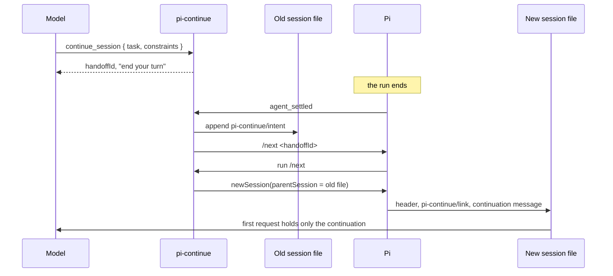

# pi-continue

pi-continue is a [Pi](https://github.com/earendil-works/pi) extension that moves your work into a new Pi session that starts with no earlier messages and no summary of them. The new session receives only the task, the active constraints copied word for word, and a link to the session it came from. When the model needs something from earlier, it reads the old session files on disk with a read-only tool.

## Install

```bash
pi install npm:@bjoernaagaard/pi-continue
# or from GitHub
pi install git:github.com/bjoernaagaard/pi-continue
```

The extension was tested with Pi 1.5.0, and it reads only version 3 session files.

## What the extension adds

```text
pi-continue
├── continue_session   tool     the model asks for a handoff
├── /next [handoffId]  command  you start or resume a handoff
├── continue_history   tool     the model reads earlier sessions
└── handlers
    ├── agent_settled  starts the handoff once the run has ended
    ├── session_start  reports handoffs that have no new session yet
    └── context        puts the task back into each request after compaction
```

You can start a handoff in two ways. The model can call `continue_session` with a task and a list of constraints, or you can type `/next` yourself after the model has made such a request. The command is called `/next` and not `/continue`, because another Pi extension, the cliproxyapi provider, already registers `continue`, and Pi renames both commands when two extensions use the same name.

## How a handoff runs



Pi creates the new session file only when it gets its first user message. The extension adds the link entry before that message, so Pi writes the link, the header and the message together. If Pi is killed before then, it leaves no new session file, and running `/next <handoffId>` again creates it.

## What the new session receives

The first message of the new session is plain text in a fixed format. The message below comes from one of the test runs:

```text
[pi-continue 8011e734-4254-435c-86da-027cb38dc602]
Task:
Find out whether the earlier marker command finished, then report.
Active constraints (verbatim):
- Do not rerun any command before checking its effect.
Possible effects of interrupted tool calls (check before repeating):
- bash call toolu_012pMxb5Mvj3X3LTHs4M3G3r at entry ba691404: aborted
Source: /path/to/sessions/2026-11-06T16-44-37-390Z_01a1b1bf-768d-70bf-b489-d5cc349e7e6d.jsonl
Source session ID: 01a1b1bf-768d-70bf-b489-d5cc349e7e6d
Source leaf ID: bfec51df
Prior history is not in this context. Use the continue_history tool to read it.
```

The section about interrupted tool calls appears only when the old session has a tool call with no result, or a result that reports an abort. The extension can't tell whether such a call changed anything, so it lists the call and leaves the check to the model.

## When the extension refuses a handoff

```text
on agent_settled
  request = latest continue_session result made in this run
  if there is no request, or it already has an intent
    do nothing
  if the run was aborted
     or messages are queued
     or a user message came after the request
    notify "handoff <id> refused ... Run /next <id> when ready"
    stop
  append the intent to the old session
  send "/next <id>"
```

A refusal writes nothing. You can start the same handoff later with `/next <handoffId>`.

## Running /next again

```text
/next [handoffId]
  if a run is active or messages are queued
    refuse
  intent = intent for handoffId, or the latest intent on this branch
           (written now from a continue_session result if none exists)
  look in the old session's folder for a session whose
    header parentSession is the old file and whose link has this handoffId
  if one exists
    switch to it, resend nothing
  else
    create the new session
```

If you run `/next` twice for one handoff, the second run finds the session that already exists. The command switches to it and sends nothing new. If the continuation in that session never got a reply, you get a notice, and you send the next message yourself.

## Reading earlier history

`continue_history` follows the link entries backwards from the current session, one session at a time. It reads each file with `readFile` and never opens, migrates or writes it.

```text
continue_history { query?, entryId?, session?, around?, maxHits?, wholeFile? }
  link = this session's pi-continue/link
  repeat
    read link.source.file
    stop if the file is missing, repeated, not version 3, or 32 sessions deep
    search the branch that ends at link.source.leafId
      (or every entry when wholeFile is true)
    link = that file's own pi-continue/link
  return excerpts with file, sessionId, entryId, role and text
```

The search is a simple word match that ignores case, and an entry counts as a hit when it contains every word in the query. Each excerpt is cut at 600 characters, a result stops at 12,000 characters or 20 hits, and the tool reports any file it skipped and why. Without `query` or `entryId`, it lists the linked sessions. The tool can miss facts that are written with different words, so it doesn't promise complete recall.

## Compaction

When Pi compacts the new session, the continuation message can drop out of the model's view. Before each request, the extension checks whether a user message still holds the full continuation text. If none does, it puts the text back at the start of that one request.

```diff
 request after /compact
+  user: [pi-continue <handoffId>] Task ... constraints ...
   user: The conversation history before this point was compacted ...
   assistant: READ
   user: Reply with only the word PONG.
```

The extension changes only the request. The session file keeps one copy of the continuation, and the extension never copies old history into the new session.

## Entries the extension writes

```text
old session (.jsonl)
└── custom  pi-continue/intent  { handoffId, task, constraints, source, uncertainEffects }

new session (.jsonl)
├── header  parentSession = path of the old session
├── custom  pi-continue/link    same data as the intent
└── message user                the continuation text
```

`source` holds the old session's file path, session ID and leaf ID at the moment of the handoff. Custom entries never reach the model.

## Limits

The extension doesn't make a handoff atomic, it doesn't promise that tool effects happen exactly once, and it doesn't promise complete recall.

- Two Pi processes that run `/next` for the same handoff at the same moment can both create a new session.
- Pi has no lock on session files, so a second Pi process can resume the old session while the new one runs.
- If Pi fails while it builds the new session, the old session is already closed. Restart Pi and resume the old session. A notice then tells you which handoff still needs `/next`.

## Source layout

```text
src/
├── extension.ts  registers the tools, the /next command and the handlers
├── handoff.ts    continuation text, intents, interrupted calls, finding an existing session
├── history.ts    reading session files, following links, search
└── schema.ts     pi-schema definitions for the entries and the tool parameters
```

## Development

```bash
npm ci
npm run check                                     # Ultracite lint and format check
npx -y -p @typescript/native-preview tsgo -p .    # type check
pi -e ./src/extension.ts                          # try the extension in Pi
```

`npm ci` also installs a Lefthook pre-commit hook, which runs `npx ultracite fix` on staged files.

## License

MIT. See [LICENSE](LICENSE).
